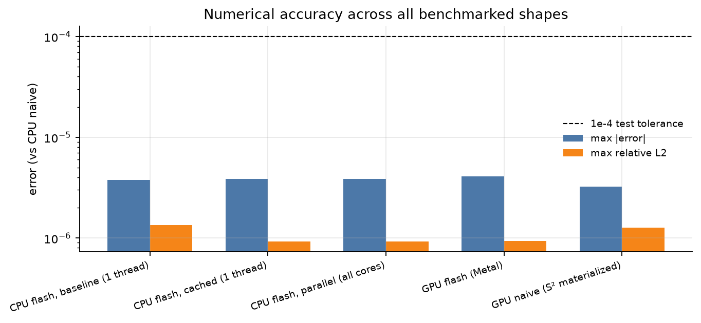
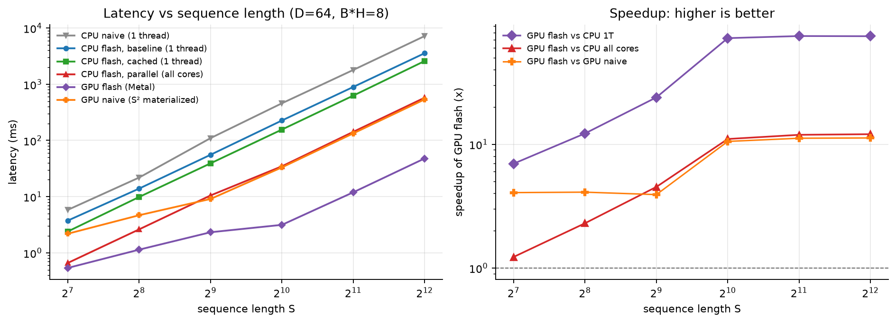
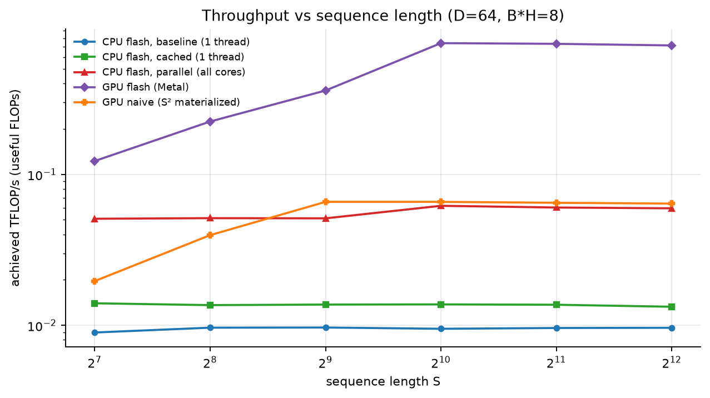
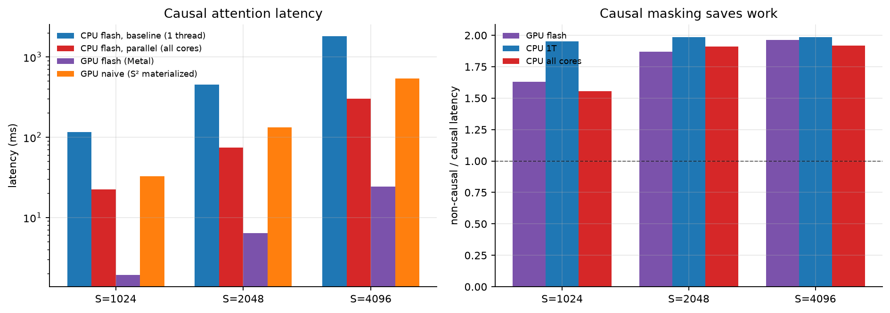
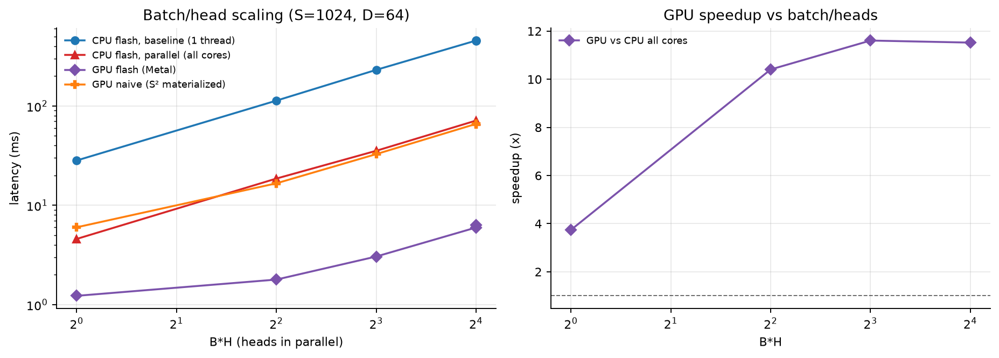
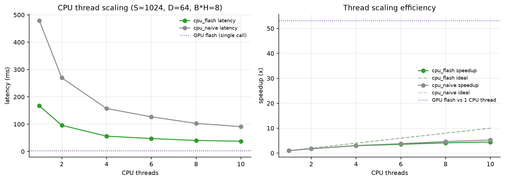
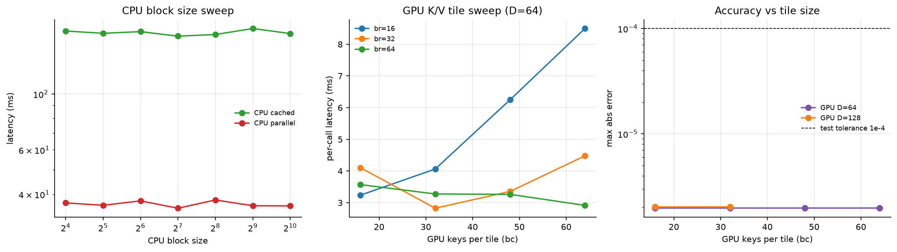
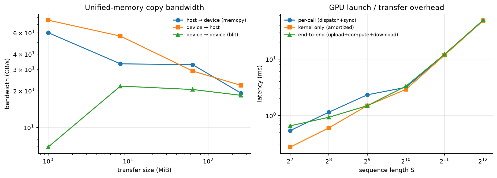
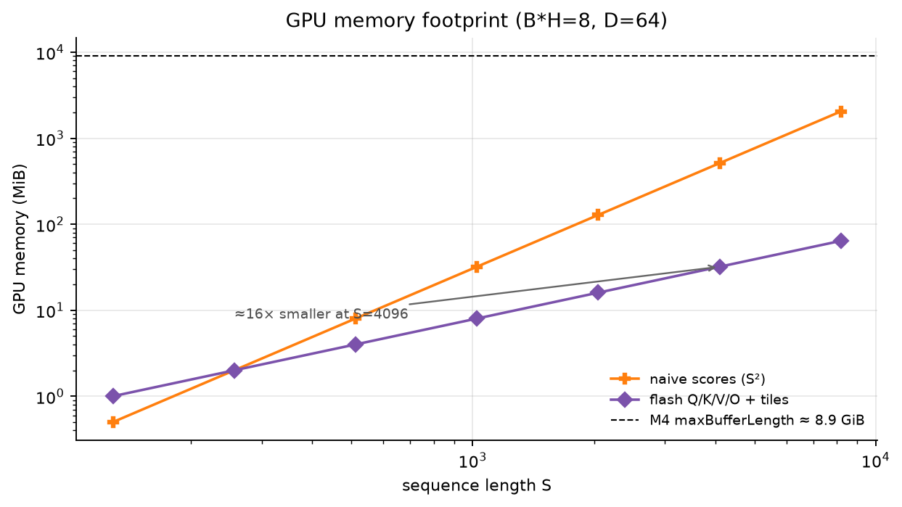

# CPU vs GPU Flash Attention：实现与全方位对比

> 中文文档；英文摘要见 [GPU_COMPARISON_EN.md](GPU_COMPARISON_EN.md)。

> 本文对比同一个 Flash Attention 算法的两种实现：
>
> - **CPU 版**：项目原有的纯 Rust、零依赖实现（`src/attention.rs`），以及本次新增的缓存版 / 多线程版（`src/cpu_opt.rs`）。
> - **GPU 版**：本次新增的 macOS Metal 实现（`src/gpu/attention.metal` + `src/gpu/mod.rs`），包含 Flash Attention 与“物化 S×S 分数矩阵”的朴素实现两条路径。
>
> 对比维度包括：正确性、延迟、吞吐、序列长度/批量/头数扩展性、causal mask、block 调参、CPU 线程扩展、启动与传输开销、显存/内存占用、可移植性与工程成本。所有数字都在同一台机器、同一套输入上测得，原始数据与复现脚本一并提供。

---

## 0. 结论速览（TL;DR）

测试环境：**MacBook Air（Apple M4，10 核 CPU = 4P+6E，10 核 GPU，16 GB 统一内存，macOS 26.6.2，Metal 4，Rust 1.99）**，B=1、H=8、D=64、非 causal（除特别注明外）。

| 结论 | 数据 |
|---|---|
| **正确性** | 所有实现（含 GPU）相对 CPU 朴素实现的 **最大绝对误差 ≤ 4.2×10⁻⁶**，远低于项目测试阈值 `1e-4` |
| **大序列（S=4096）** | GPU Flash **47.8 ms**；CPU 原版单线程 3 570 ms（**74.7×**）；CPU 优化单线程 2 590 ms（**54.2×**）；CPU 10 线程 576 ms（**12.1×**） |
| **对比 GPU naive** | GPU Flash 比“物化 S×S 矩阵”的 GPU 朴素实现快 **11.2×**（47.8 ms vs 537.5 ms） |
| **小序列（S=128）** | GPU 0.54 ms；CPU 10 线程 0.66 ms（**1.2×**）；CPU 单线程 3.75 ms（7.0×）。小任务上 GPU 的优势被启动/同步开销吃掉 |
| **吞吐** | GPU Flash 在 S≥1024 稳定在 **0.72–0.74 TFLOP/s**；CPU 10 线程约 0.06 TFLOP/s，CPU 单线程约 0.014 TFLOP/s |
| **GPU 吞吐** | **0.72–0.74 TFLOP/s**（约为 CPU 单线程的 50×、10 线程的 12×）；瓶颈是 SIMD 归约、exp、shared memory 访问和指令级并行，而不是显存带宽 |
| **显存** | S=4096 时 naive 分数矩阵 **512 MiB**，Flash 的 Q/K/V/O **32 MiB**，**16×** 差距；S=8192 时 naive 需要 2 GiB，接近 8.88 GiB 的单 buffer 上限 |
| **Causal** | GPU 上 causal 比 non-causal 快 **1.6–2.0×**（S=4096 时 47.8 → 24.3 ms）；CPU 约 2.0× |
| **CPU 多线程** | 10 线程相对 1 线程只有 **4.45×**（效率 44%），受 4P+6E 与内存带宽限制 |
| **一次性成本** | Metal 设备/队列 ~30 ms；每个 head dim 的 MSL 编译 + pipeline 创建 **40–72 ms**；首次调用约 41 ms；热调用 0.78 ms |

一句话：**GPU 版在 S≳256 的中长序列上全面胜出，S=1024 起相对 10 线程 CPU 也有约 11×；但小序列、一次性调用、以及需要跨平台/Python 的场景，CPU 版仍然更合适。**

---

## 1. 对比对象与实验方法

### 1.1 六个实现

| 实现 | 代码 | 算法 | 并行方式 | 内存特征 |
|---|---|---|---|---|
| `cpu_naive` | `src/attention.rs` | 逐 query 全量 softmax | 单线程 | 每行 O(S) scratch |
| `cpu_flash_1t` | `src/attention.rs` | 分块在线 softmax（原版） | 单线程 | 每 query O(block+D) |
| `cpu_cached_1t` | `src/cpu_opt.rs` | 分块 + 缓存 tile 分数 | 单线程 | 每线程 O(block+D) |
| `cpu_parallel` | `src/cpu_opt.rs` | 分块 + 缓存 + 行级切分 | `std::thread`，10 线程 | 每线程 O(block+D) |
| `gpu_flash` | `src/gpu/` | Metal 分块在线 softmax | 每 query 4/8 lane，threadgroup 128–512 线程 | Q/K/V/O + 32 KiB threadgroup |
| `gpu_naive` | `src/gpu/` | 三步：score → softmax → P·V | 每元素一个线程 | **额外 O(B·H·S²)** 分数矩阵 |

> CPU 原版与优化版都保留，是为了把“算法优化带来的提升”和“硬件带来的提升”分开：
> 原版单线程 → 缓存版单线程约 **1.4×**，缓存版 → 10 线程约 **4.5×**，10 线程 → GPU 约 **11×**（S=1024）。

### 1.2 硬件与软件环境

| 项目 | 值 |
|---|---|
| 机型 | MacBook Air (Mac16,12)，**无风扇** |
| SoC | Apple M4，10 核 CPU（4 性能 + 6 能效），10 核 GPU |
| 内存 | 16 GB 统一内存（LPDDR5X） |
| GPU 框架 | Metal 4，`maxThreadgroupMemoryLength = 32 768 B`，`maxBufferLength ≈ 8.88 GiB` |
| 系统 | macOS 26.6.2 |
| 工具链 | rustc 1.99.0，Rust edition 2024 |
| 依赖 | CPU：零依赖；GPU：`metal 0.33` + `objc 0.2` |

### 1.3 测量协议与注意事项

- **CPU**：先做一次 warm-up，再测 `iterations` 次，取中位数；迭代次数按 FLOP 量自适应（1–12 次）。
- **GPU**：调用 `GpuAttention::benchmark_*`，分别报告
  - `per_call`：每次 dispatch 后 `waitUntilCompleted`，**包含 launch + 同步开销**；
  - `amortized`：把 N 次 dispatch 塞进同一个 command buffer，**kernel-only 时间**；
  - `end_to_end`：每次上传 Q/K/V + dispatch + 下载输出，**包含 host↔device 拷贝**。
  表中“延迟”列使用 `per_call`，吞吐列使用 `amortized`，另列 `e2e`。
- **误差**：一律与原始单线程 `naive_attention` / `naive_attention_causal` 比较，报告 max abs、mean abs、relative L2。
- **热噪声与调度抖动**：MacBook Air 无风扇，持续 GPU 负载会降频。实测 **kernel-only（amortized）在同配置下稳定在约 ±5%**，但 **per-call 中位数受系统调度/时钟爬升影响可达 ±40%**（例如 S=1024 的 per-call 在 2.9–5.0 ms 之间波动，而 kernel-only 稳定在 2.9 ms 左右）。因此所有 speedup 都用 per-call 计算，属于偏保守的口径；判断时请看数量级与 kernel-only 列，不要过度解读 10% 的差异。
- **公平性**：GPU 端 buffer 预先分配（resident），只重复 dispatch；CPU 端每次调用会重新分配输出与 scratch。这对 GPU 略有利，但 `end_to_end` 列给出了包含传输的现实成本。GPU 的 `per_call` 包含每次命令缓冲/同步开销，而 CPU 调用没有类似开销，因此 GPU 数字并不“占便宜”。
- **线程池**：CPU `cpu_parallel` 每次调用都 `std::thread::scope` 新建线程，包含线程创建开销；这是该 API 形态的真实成本，未使用常驻线程池。

### 1.4 复现

```bash
# 全部单元测试（含 GPU）
cargo test --features metal

# 完整对比实验（约 2–3 分钟）
cargo run --release --features metal --bin compare

# 生成图表与 Markdown 表格
.venv/bin/python scripts/report.py

# 快速模式（缩短序列/迭代，用于冒烟）
cargo run --release --features metal --bin compare -- --quick
```

原始数据：`results/timings.csv`、`results/blocksize.csv`、`results/threads.csv`、`results/transfer.csv`、`results/startup.csv`、`results/meta.txt`。完整表格：`results/tables.md`。图表：`results/charts/`。

---

## 2. 实现设计

### 2.1 CPU 原版与优化版

原版 `scaled_dot_product_attention` 已经是标准的在线 softmax：

- 对每个 `(b,h,i)` 维护 `m`（当前最大 logit）、`l`（分母）、`o`（输出累积）；
- K/V 按 `block_size` 分块，先求块最大 `block_m`，再 `exp(score - block_m)` 累积；
- 用 `alpha = exp(m - new_m)`、`beta = exp(block_m - new_m)` 合并。

它的两个性能问题是：**每个 tile 的 QK 分数被计算两次**（求 max 一次、求 exp 一次），以及**内层循环里反复分配 `o`/`block_o`**。

`src/cpu_opt.rs` 做了三件事：

1. **缓存 tile 分数**：一次 QK 写入 `scores[block]`，再统一求 max / exp；
2. **复用 scratch**：每个线程只分配一次 `o` 和 `scores`；
3. **行级并行**：`out.data.chunks_mut(...)` 把 `B*H*S` 行切成连续块，`std::thread::scope` 每块一个线程，无锁、无 unsafe。

> 这仍然是 O(S·D) 的在线 softmax 语义，数值结果与原版在 `1e-5` 内一致（有单测覆盖 1/2/3/7/8/16 线程与 causal）。

### 2.2 GPU Flash Attention 的线程映射

GPU kernel 的目标是：**每 8/4 个 lane 负责一个 query，K/V tile 在 threadgroup 内复用，在线 softmax 状态留在寄存器里**。

```
threadgroup（br=32, D=64 时 128 线程 = 4 warps）
├─ 每个 query 由 4 个 lane 负责（D=64）或 8 个 lane（D=128）
│   ├─ 每 lane 持有 q[dim/lanes] 和 o[dim/lanes]（寄存器）
│   └─ 每 lane 负责连续的 dim/lanes 个通道
├─ shared memory: K tile [bc][D] + V tile [bc][D]
│   └─ 2 * bc * D * 4 B ≤ 32 KiB（D=64 时 bc≤64，D=128 时 bc≤32）
└─ 外层循环：for each K/V tile
    ├─ 协作把 K/V 从 global 搬到 threadgroup（float4）
    ├─ barrier
    ├─ 以 8 个 key 为子块：
    │   ├─ 每 lane 算 8/16 通道的部分点积 → simd_shuffle_xor 归约 → score
    │   ├─ 本子块 8 个 score 存寄存器 sreg[8]
    │   ├─ 求 block max → new_m → 一次 rescale o/l
    │   └─ 8 个 exp 独立计算 + P·V 累加
    └─ barrier
```

关键设计点：

1. **在线 softmax 的“子块”化**：如果每来一个 key 就更新 `m/l/o`，会形成一条 `exp → new_m → l → o` 的串行依赖链，GPU 的 exp 延迟无法被掩盖。改为每 8 个 key 一批：先算完 8 个 score，求块最大，再一次性 rescale，8 个 exp 相互独立。这是本实现相对最初版本的主要优化。
2. **q/o 放寄存器，K/V 放 threadgroup**：q 和输出累积只在本 lane 使用，留在寄存器最划算；K/V 被 `br` 个 query 复用，放 shared memory。
3. **causal mask 用 `-inf` 而不是分支**：SIMD-group 操作要求 warp 内所有 lane 参与，因此不能在 key 循环里 `continue`。causal 时把 `j > i` 的 score 置为 `-INFINITY`，`exp(-inf)=0`，同步 softmax 语义不变。
4. **按 head dim 特化 MSL**：`LANE_DIM = dim / lanes`、`QUERY_LANES = 4/8` 在编译期注入，内层循环可以完全展开成 float4 访存。
5. **pipeline 缓存**：每个 `dim` 只编译一次（4 个 kernel：flash / scores / softmax / pv），之后复用 `ComputePipelineState`；benchmark 里 buffer 也复用。
6. **尾块处理**：`seq` 不是 `br` 的整数倍时，多出来的 query 用最后一个合法 query 的数据参与计算、但不写回；`seq` 不是 `bc` 的整数倍时，K/V tile 尾部补零，score 置 `-inf`。

### 2.3 GPU naive 基线

为了量化“不物化 S×S 矩阵”到底省了什么，另写了三条最直白的 Metal kernel：

1. `scores_kernel`：每个 `(i,j)` 一个线程，算 `q_i·k_j`，写入 `scores[b,h,i,j]`（causal 时写 `-inf`）；
2. `softmax_rows_kernel`：每行一个线程，三趟扫描求 max / exp / 归一化；
3. `pv_kernel`：每个 `(i,d)` 一个线程，沿 j 累加 `P[i,j]·V[j,d]`。

它没有做 tile、没有做寄存器复用，代表“GPU 上最直观的 attention 写法”。它的价值有两个：作为 GPU 正确性对照，以及展示 **O(S²) 显存** 的代价。

### 2.4 设计取舍对照

| 维度 | CPU 原版 | CPU 优化版 | GPU Flash | GPU naive |
|---|---|---|---|---|
| 并行粒度 | 无 | 行（10 线程） | query×lane，threadgroup | 元素 |
| 分数矩阵 | 不物化（逐行） | 不物化（逐 tile） | 不物化 | **物化** |
| 每 query 状态 | m/l/o | m/l/o | m/l + 寄存器 o | 无 |
| scratch 内存 | 每 query O(block+D) | 每线程 O(block+D) | 32 KiB/group + 4 个张量 | + O(B·H·S²) |
| 数值精度 | f32 | f32 | f32（`fast::exp`） | f32 |
| 依赖 | 0 | 0 | metal + objc | 同左 |

---

## 3. 正确性对比

`cargo test --features metal` 共 **13 个测试全部通过**，其中 GPU 侧覆盖：

- D = 8/16/32/64/128，S = 8/17/33/64/1000，causal 与非 causal；
- block_size = 16/32，query_block = 8/32，以及 `block=16` 的尾块；
- scale = 默认与 `8.0`（大 logit，检验 online softmax 稳定性）；
- 非 2 的幂形状（S=777、333，causal）；
- GPU naive 与 GPU flash 分别对 CPU naive 做逐元素比较；
- 非法参数（dim=12、block=24、query_block=6）被拒绝。

全量 benchmark 中，各实现相对 CPU naive 的误差：

| 实现 | 最大绝对误差 | 最大 relative L2 | 最差用例 |
|---|---|---|---|
| `cpu_flash_1t` | 3.76e-6 | 1.34e-6 | S=4096, D=64 |
| `cpu_cached_1t` | 3.87e-6 | 9.21e-7 | S=4096, D=64, causal |
| `cpu_parallel` | 3.87e-6 | 9.21e-7 | S=4096, D=64, causal |
| `gpu_flash` | **4.11e-6** | 9.34e-7 | S=4096, D=64, causal |
| `gpu_naive` | 3.22e-6 | 1.27e-6 | S=4096, D=64, causal |



**解读**：误差全部来自 f32 的求和顺序差异，GPU 的 `fast::exp` 没有带来可观测的额外误差；4×10⁻⁶ 比测试阈值低两个数量级。需要注意，这是“与 CPU f32 参考实现”的差异，不代表与 float64 参考的差异；若需要严格数值验证，应再引入 f64 参考。

---

## 4. 性能对比

### 4.1 延迟随序列长度（D=64，B·H=8，非 causal）



| S | CPU naive | CPU flash 1T | CPU cached 1T | CPU 10 线程 | **GPU flash** | GPU naive |
|---:|---:|---:|---:|---:|---:|---:|
| 128 | 5.81 ms | 3.75 ms | 2.40 ms | 0.660 ms | **0.538 ms** | 2.19 ms |
| 256 | 21.9 | 13.9 | 9.87 | 2.62 | **1.14** | 4.67 |
| 512 | 110 | 55.6 | 39.1 | 10.5 | **2.32** | 9.09 |
| 1024 | 458 | 227 | 156 | 34.7 | **3.15** | 33.1 |
| 2048 | 1797 | 895 | 628 | 142 | **11.95** | 133.6 |
| 4096 | 7206 | 3570 | 2590 | 576 | **47.83** | 537.5 |

| S | GPU / CPU 1T | GPU / CPU 10T | GPU flash / GPU naive | GPU TFLOP/s |
|---:|---:|---:|---:|---:|
| 128 | 7.0× | 1.2× | 4.1× | 0.12 |
| 256 | 12.2× | 2.3× | 4.1× | 0.22 |
| 512 | 23.9× | 4.5× | 3.9× | 0.36 |
| 1024 | 72.0× | 11.0× | 10.5× | 0.74 |
| 2048 | 74.9× | 11.9× | 11.2× | 0.73 |
| 4096 | **74.7×** | **12.1×** | **11.2×** | 0.72 |

观察：

- 三者都呈 O(S²) 增长（log-log 斜率约 2），但 GPU 的绝对时间低 1.5–2 个数量级。
- **交叉点**：对 10 线程 CPU，S=128 时 GPU 仅快 1.2×；S=256 时 2.3×；S=512 起拉开到 4.5×。对单线程 CPU，S=128 已有 7×。
- GPU Flash 在 S=128→512 的 per-call 时间里，launch/同步占比很高（kernel-only 约 0.27/0.60/1.49 ms，而 per-call 为 0.54/1.14/2.32 ms），所以小序列的 speedup 被压低。
- GPU naive 的吞吐大致相当于 10 线程 CPU（S=1024：33.1 vs 34.7 ms），S=128 时 2.19 ms 也快于 CPU 单线程的 2.40 ms；但它比 GPU Flash 慢 4–11×，而且显存是 O(S²)。
- **读数注意**：S=512 的 per-call 中位数（2.32 ms）明显高于同配置 kernel-only（1.49 ms），属于系统噪声/同步抖动；该行 speedup 偏保守。其余点的 per-call 与 kernel-only 差值约 0.2–0.3 ms，符合 launch+同步的预期。

### 4.1.1 D=128 的扩展

D=128 时 kernel 用 8 lane/query（D≤64 用 4 lane），shared tile 上限降到 bc≤32，计算量翻倍：

| S | CPU 1T | CPU 10 线程 | GPU Flash | GPU naive | GPU / CPU 10T |
|---:|---:|---:|---:|---:|---:|
| 256 | 24.0 ms | 4.57 ms | **1.08 ms** | 3.95 ms | 4.2× |
| 512 | 99.3 | 19.6 | **2.03** | 10.1 | 9.7× |
| 1024 | 385.9 | 77.7 | **6.60** | 41.2 | 11.8× |
| 2048 | 1545.7 | 259.1 | **25.91** | 167.2 | 10.0× |

D=128 与 D=64 的规律一致：S=1024 左右达到 ~0.69 TFLOP/s，相对 10 线程 CPU 约 10–12×。S=2048 时 GPU/CPU 10T 略降到 10×，因为 GPU 的 tile 上限（bc=32）导致 K/V 复用率低于 D=64 的 bc=64。

### 4.2 吞吐与瓶颈分析



- CPU 单线程 cached：约 **0.014 TFLOP/s**（与理论单核 FP32 同量级）；
- CPU 10 线程：约 **0.06 TFLOP/s**；
- GPU Flash：S≥1024 稳定在 **0.72–0.74 TFLOP/s**；
- GPU naive：约 **0.064 TFLOP/s**（和 10 线程 CPU 相当，但显存高 16×）；

绝对峰值利用率没有被可靠标定：在 Metal 上写一个“纯 FMA”微基准很容易被编译器折叠成闭式表达式或消除未使用分量，从而测出明显偏高的数字；本报告因此不引用这类峰值，只比较**同一 harness 下实测到的 0.72–0.74 TFLOP/s**。从性能模型看，这个 kernel 的瓶颈是计算、访存、控制流的混合比例，而不是单一资源：

1. 每个 key 要做 **2 次 SIMD 子组归约**（D=64 时 4 lane）或 3 次（D=128 时 8 lane），`simd_shuffle_xor` 在关键路径上；
2. 每个 key 每 lane 1 次 `exp`（虽然 8 个 key 一批，已消除跨 key 依赖，但 SFU 吞吐仍是限制）；
3. K/V 从 threadgroup 读取：每个 key 每 lane 读 2×(D/lanes) 个 float，shared memory 带宽与 broadcast 效率决定上限；
4. 没有使用 **simdgroup matrix（8×8 MMA）**，所有点积都是标量 FMA；这是与真正高性能 FlashAttention Metal kernel 最大的差距。

因此，这组数字应解读为“**一个正确、可读、比 CPU 快 1–2 个数量级的手写 kernel**”，而不是“M4 GPU 的 attention 上限”。后续若用 `simdgroup_float8x8` 重写 QK/PV，预期还有 1.5–3× 空间（见第 8 节）。

### 4.3 Causal mask



| S | CPU 1T | CPU 10 线程 | GPU Flash | GPU naive | GPU / CPU 10T | GPU 误差 |
|---:|---:|---:|---:|---:|---:|---:|
| 1024 | 116.2 ms | 22.3 ms | **1.93 ms** | 32.8 ms | 11.5× | 1.61e-6 |
| 2048 | 450.7 | 74.6 | **6.39** | 133.0 | 11.7× | 2.32e-6 |
| 4096 | 1797.8 | 300.4 | **24.35** | 536.1 | 12.3× | 4.11e-6 |

- CPU 的 causal 加速接近理论 2×（S=4096：3570 → 1798 ms）。
- GPU 的 causal 加速为 **1.6–2.0×**（47.8 → 24.3 ms）。略低于 2× 的原因是：threadgroup 以 `br` 个 query 为单位推进，块内低编号 query 会为高编号 query 的 key 做一部分“被 mask 的无效计算”；tile 越粗，浪费越大。
- causal 下 GPU 相对 10 线程 CPU 的领先稳定在 **11–12×**，与非 causal 同量级。
- 对比之下，GPU naive 的 causal 几乎不省时间（S=4096：536 ms vs 537 ms）：它仍然物化并写满整个 S×S 矩阵，只是把被 mask 的 score 置为 `-inf`；这说明“算法层面的跳过”与“显存层面的跳过”是两回事。

### 4.4 Batch / head 扩展



| B·H | CPU 1T | CPU 10 线程 | GPU Flash | GPU naive | GPU / CPU 10T |
|---:|---:|---:|---:|---:|---:|
| 1 | 28.3 ms | 4.58 ms | **1.23 ms** | 6.00 ms | 3.7× |
| 4 | 113 | 18.6 | **1.79** | 16.6 | 10.4× |
| 8 | 231 | 35.4 | **3.05** | 32.7 | 11.6× |
| 16 | 456 | 71.2 | **5.97** | 66.0 | 11.9× |

- GPU 的延迟随 B·H 近似线性增长（1.23 → 5.97 ms，4.9× / 16× 工作量），说明 GPU 在 B·H=8 时已基本填满；B·H=1 时只有 1.2 ms，kernel 利用率不足。
- CPU 10 线程同样近似线性；因此 speedup 在 B·H=8–16 时稳定在 11–12×。
- 这也解释了为什么真实推理常用较大的 batch/head 或把多个请求拼 batch：GPU 需要足够多的 threadgroup 才能摊薄 launch 与尾部效应。

### 4.5 CPU 多线程扩展



S=1024、D=64、B·H=8：

| 线程数 | Flash ms | Flash 加速比 | Flash 效率 | Naive ms | Naive 加速比 |
|---:|---:|---:|---:|---:|---:|
| 1 | 167.1 | 1.00× | 100% | 478.9 | 1.00× |
| 2 | 95.8 | 1.74× | 87% | 269.6 | 1.78× |
| 4 | 56.2 | 2.97× | 74% | 157.4 | 3.04× |
| 6 | 47.3 | 3.53× | 59% | 126.9 | 3.77× |
| 8 | 40.5 | 4.13× | 52% | 102.9 | 4.66× |
| 10 | 37.6 | **4.45×** | **44%** | 91.0 | 5.26× |

- 4 线程（4 个性能核）内接近线性（2.97× / 4 = 74%）；超过 4 线程后，6 个能效核 + 内存带宽 + 每次调用新建线程的开销使效率降到 44%。
- 即使 10 线程，CPU 仍比 GPU Flash 慢 **11×**（S=1024：37.6 ms vs 3.15 ms）。
- Naive 的线程扩展略好于 Flash，因为它是纯计算、每行独立、没有跨块 rescale；但起点慢 3×。

### 4.6 Block / tile 调参



**CPU（S=1024，D=64）**：block 从 16 到 1024，cached 单线程 169.5–181.8 ms，10 线程 35.2–38.0 ms，波动 < 8%。原因是 CPU 的瓶颈在 QK/PV 的 FMA 与内存访问，而不在 tile 大小；block 只要不太小（避免循环开销）即可。

**GPU（S=1024，D=64）**：同样 12 组 `(bc, br)`，per-call 从 **2.83 ms**（bc=32, br=32）到 **8.49 ms**（bc=64, br=16），有 **3×** 的差异：

| bc \ br | 16 | 32 | 64 |
|---:|---:|---:|---:|
| 16 | 3.24 | 4.10 | 3.57 |
| 32 | 4.06 | **2.83** | 3.28 |
| 48 | 6.25 | 3.36 | 3.26 |
| 64 | 8.49 | 4.48 | 2.92 |

- **br=32 最稳**；br=16 在 bc=64 时特别差，因为每个 threadgroup 只有 64 个线程（4 lane/query），无法掩盖 shared memory 与 exp 延迟。
- **bc=64 需要配 br=64** 才能接近最优；bc=32 + br=32 是综合最佳。
- D=128 时最优也是 bc=32, br=32（约 6.07 ms），bc=16 约 6.8–8.5 ms，bc=32 + br=16 最差（10.3 ms）。
- 对使用者：D=64 建议默认 `block_size=32, query_block=32`；D=128 用 `32/32`；不要用 `query_block=16`。

### 4.7 启动、launch 与传输开销

| 一次性/固定成本 | 时间 |
|---|---:|
| `GpuAttention::new()`（设备 + 队列） | ~30 ms |
| MSL 编译 + 4 个 compute pipeline（D=64） | ~72 ms |
| MSL 编译 + 4 个 compute pipeline（D=128） | ~41 ms |
| 首次 `flash_attention`（含编译） | ~41 ms |
| 第二次 `flash_attention`（热） | 0.78 ms |



- **启动成本**：GPU 端每个 head dim 需要一次 40–72 ms 的 MSL 编译；CPU 端为 0。对于“只调用一次、S=128”的场景，GPU 的 0.54 ms 计算 + ~100 ms 启动，反而不如 CPU。
- **launch/同步**：S=1024 时 per-call 3.15 ms，kernel-only 2.90 ms，e2e 3.30 ms → launch+同步约 0.25 ms，传输约 0.4 ms。S=4096 时 kernel 47.99 ms，e2e 49.08 ms → 传输 < 3%。
- **host↔device 带宽**：1 MiB 时 60–76 GB/s（cache 友好），256 MiB 时 19–22 GB/s；device→device blit 6.9 GB/s（1 MiB）到 22 GB/s（8 MiB 以上），小拷贝受 launch 影响明显。
- **便捷 API 的分配开销**：`GpuAttention::flash_attention` 每次调用都会新建 Q/K/V/O 四个 shared-storage buffer；实测 S=512 约 3–4.5 ms、S=1024 约 6.5–12 ms，比 resident `e2e`（1.5 / 3.3 ms）高 2–3×。表格中的 e2e 是**复用 buffer** 的数字；真实业务若要低延迟，应复用 workspace（当前公共 API 每次分配，buffer 复用是后续改进项）。
- 结论：**GPU 适合“数据已在显存、反复调用”的推理循环；如果是“每次从 host 拷入、只算一次”，传输、分配与启动会把小序列的优势抵消。**本项目 benchmark 的 `amortized` 列代表 kernel-only，`e2e` 列代表复用 buffer 的单次调用，便捷 API 还要再加上分配开销。

### 4.8 热与能效

- MacBook Air 无风扇，持续 GPU 负载会降频。本报告的 GPU 数据是短突发中位数：kernel-only 约 ±5%，per-call 可能 ±40%；不同散热条件（MacBook Pro / 主动散热）可能得到更高的稳定频率。
- 未测功耗（需要 `powermetrics` 与 sudo）。粗略看，GPU 在 1/75 的时间内完成同样的 FLOP，**每 FLOP 的能耗大概率更低**，但 idle 功耗、启动功耗与小任务能效需要单独测量，不能仅凭时间推断。

---

## 5. 显存 / 内存对比



**GPU（B·H=8，D=64）**：

| S | naive 分数矩阵 | Flash Q/K/V/O | 比例 |
|---:|---:|---:|---:|
| 512 | 8 MiB | 4 MiB | 2.0× |
| 1024 | 32 MiB | 8 MiB | 4.0× |
| 2048 | 128 MiB | 16 MiB | 8.0× |
| 4096 | **512 MiB** | **32 MiB** | **16×** |
| 8192 | 2048 MiB | 64 MiB | 32× |

- Flash 的显存是 **O(B·H·S·D)**：4 个张量 + 每个 threadgroup 32 KiB；S=8192 也只要 64 MiB。
- naive 的分数矩阵是 **O(B·H·S²)**：S=4096 已 512 MiB，S=8192 2 GiB，S≈16384 时 8 GiB，逼近 `maxBufferLength` 8.88 GiB；再大就直接分配失败（本项目的 `prepare` 会返回 `GpuError::Memory`，不会 panic）。
- naive 的 544 MiB 实测 `gpu_bytes`（S=4096）= 512 MiB scores + 32 MiB 的 Q/K/V/O。

**CPU**：原版 naive 是**逐 query 处理**，每行只分配 O(S) 的 `scores/weights`，并不会物化 B·H·S²；所以 CPU naive 的内存其实很省，代价是慢。GPU naive 之所以显存爆炸，是因为它把 S×S 矩阵物化到 global memory 以获得并行度——这是“GPU 并行化 naive 算法”的典型代价，而不是算法本身必须。

---

## 6. 工程与可移植性

| 维度 | CPU 版 | GPU 版 |
|---|---|---|
| 语言 | Rust | Rust + MSL |
| 代码量 | `attention.rs` 628 行 + `cpu_opt.rs` 406 行 | `gpu/mod.rs` 1042 行 + `attention.metal` 329 行 |
| 依赖 | 0（核心） | `metal` + `objc`（+12 个传递依赖） |
| 平台 | 任意 Rust 平台 | **仅 macOS**（Metal） |
| 构建 | `cargo build` | `cargo build --features metal`；MSL 在运行时编译，无需 build.rs |
| 启动 | 0 | 30 ms + 每个 dim 40–72 ms |
| Python 绑定 | 有（PyO3，可选） | **暂无**（只暴露 Rust API） |
| 形状约束 | 任意 D | D 必须是 8 的倍数且 ≤128；block 必须是 16 的倍数 |
| 调试 | 普通 Rust 调试器 | MSL 编译错误在运行时返回；无源码级 GPU 调试 |
| 确定性 | 每行固定顺序，确定 | 每个 threadgroup 内固定 shuffle 顺序，无 atomics，确定 |
| 精度 | f32 | f32（`fast::exp`） |

**可移植性**：GPU 后端目前与 Metal 绑定。如果要支持 CUDA/ROCm，建议把“设备/缓冲/调度”抽成 trait，把 attention 的 tile 参数与 dispatch 逻辑复用；kernel 本身仍需各平台重写（CUDA C++ / HIP / MSL）。

**Python**：`src/lib.rs` 里的 PyO3 绑定仍只调用 CPU 实现。若要在 Python 里用 GPU，需要新增 `flash_attention_gpu_py`，并处理 maturin 与 `metal` feature 的组合；本次未做，以免扩大构建矩阵。

---

## 7. 什么时候用哪个？

| 场景 | 建议 |
|---|---|
| 序列较短（S < 256）且只调用一次 | **CPU 10 线程**：启动成本为 0，S=128 时甚至略快于 GPU |
| 序列中等/较长（S ≥ 512），重复调用 | **GPU Flash**：S=1024 起相对 10 线程 CPU 约 11×，S=4096 约 12× |
| 需要最低延迟的单次调用 | 数据已在显存 → GPU；否则把传输算进去，S=1024 以下可能仍是 CPU |
| 显存受限 / S 很大 | **GPU Flash**（O(S·D)）或 CPU；**不要**用 GPU naive |
| 需要跨平台 / Windows / Linux | **CPU 版**（GPU 后端目前仅 macOS） |
| 需要在 Python 中调用 | **CPU 版**（GPU Python 绑定尚未实现） |
| 学习/教学 | 先读 CPU 版（算法清晰），再读 GPU 版（线程映射与在线 softmax 的并行化） |
| 追求极限吞吐 | 当前 GPU kernel 还有 1.5–3× 空间（simdgroup MMA、FP16），CPU 侧可上更激进的 SIMD/线程池 |

---

## 8. 可改进方向

按收益/成本排序：

1. **simdgroup matrix（8×8 MMA）**：用 `simdgroup_float8x8` 做 QK 和 P·V，替代标量 FMA + shuffle 归约。这是 Metal 上高性能 attention 的标准做法，预期把 0.7 TFLOP/s 提升到 1.5–3 TFLOP/s。
2. **FP16/BF16**：M4 GPU 的 half 吞吐更高、shared memory 占用减半；需要注意 softmax 用 f32 累积，输出再转 half。
3. **double buffering / async copy**：当前 K/V tile 是“load → barrier → compute → barrier”，可以用两个 tile 轮换，重叠 global→shared 拷贝与计算。
4. **减少归约开销**：把 8 lane/query 改为 4 lane/query（本项目在 D≤64 已这么做），或让一个 lane 处理多个 key，降低 shuffle 次数。
5. **CPU 侧**：常驻线程池避免每次调用创建线程；NEON intrinsics 替代自动向量化；query 分块复用 K tile。
6. **Python GPU 绑定**：新增 `flash_attention_gpu_py`，让 NumPy 用户直接使用。
7. **CUDA/ROCm 后端**：抽象设备层，扩大可移植性。
8. **能耗测量**：`powermetrics` + 固定频率，测 J/FLOP，而不仅是时间。
9. **更严格的数值验证**：加 f64 参考实现，区分“与 f32 参考的差异”和“真实数值误差”。

---

## 附录 A：图表与原始数据

| 文件 | 内容 |
|---|---|
| `results/timings.csv` | 各实现、各形状的延迟 / 吞吐 / e2e / TFLOPS / 误差 / 显存 |
| `results/blocksize.csv` | CPU block 与 GPU `(bc, br)` 扫描 |
| `results/threads.csv` | CPU 1/2/4/6/8/10 线程扫描 |
| `results/transfer.csv` | host↔device、device↔device 带宽 |
| `results/startup.csv` | 设备创建、MSL 编译、首调用/热调用 |
| `results/meta.txt` | 机器、GPU、Rust 版本与限制 |
| `results/tables.md` | 由脚本生成的全部 Markdown 表格 |
| `results/charts/` | 本文全部图表 |

## 附录 B：文件地图（本次新增/修改）

```
Cargo.toml                  # 新增 metal feature、metal/objc 依赖、compare bin
src/gpu/mod.rs              # Metal 后端：设备/管线/缓冲/调度/计时/校验（1042 行）
src/gpu/attention.metal     # Flash + naive 的 4 个 MSL kernel（329 行）
src/cpu_opt.rs              # CPU 缓存版 + 多线程版（406 行）
src/bin/compare.rs          # 对比实验 harness（1263 行）
scripts/report.py           # 由 CSV 生成图表与表格（670 行）
results/                    # 原始数据、图表、表格
GPU_COMPARISON.md           # 本文
```

## 附录 C：如何复现本文数字

```bash
# 1. 测试（CPU + GPU，13 个测试）
cargo test --features metal

# 2. 全量 benchmark（约 2–3 分钟，取决于机器）
cargo run --release --features metal --bin compare

# 3. 生成图表与表格
python3 -m venv .venv
.venv/bin/pip install pandas matplotlib
MPLCONFIGDIR=$PWD/.matplotlib-cache .venv/bin/python scripts/report.py
```

> 注意：本机是**无风扇 MacBook Air**；GPU 数据为短突发中位数，重复运行可能有 5–20% 波动。若在 MacBook Pro 或主动散热机器上复现，绝对数字会更高，但量级关系（GPU 在 S≥512 领先、S=128 接近、GPU naive 的 O(S²) 显存墙）应保持一致。
