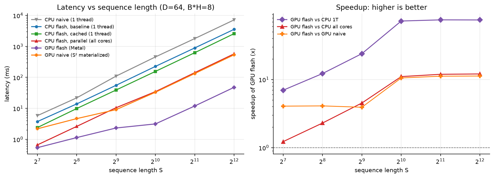

# CPU vs GPU Flash Attention — English Summary

[中文完整报告](GPU_COMPARISON.md) | English

This repository now contains two implementations of the same Flash Attention
algorithm:

- **CPU**: the original zero-dependency Rust implementation, plus cached and
  multi-threaded variants in `src/cpu_opt.rs`.
- **GPU**: a macOS Metal implementation in `src/gpu/` (MSL kernels + Rust
  driver), including a materialized-score naive baseline.

The full Chinese report is [`GPU_COMPARISON.md`](GPU_COMPARISON.md); this page is
the short English version. Raw data lives in `results/`, charts in
`results/charts/`, and all tables in `results/tables.md`.

## Environment

Apple M4 MacBook Air (fanless), 10-core CPU (4P + 6E), 10-core GPU, 16 GB unified
memory, macOS 26.6.2, Metal 4, rustc 1.99, Rust 2024. CPU path has zero
dependencies; GPU path uses `metal 0.33` + `objc 0.2`.

## Headline results

B=1, H=8, D=64, non-causal, batch*heads=8; latency in ms (GPU = median per-call
including launch/sync).

| S | CPU naive 1T | CPU flash 1T | CPU cached 1T | CPU 10T | **GPU flash** | GPU naive |
|---:|---:|---:|---:|---:|---:|---:|
| 128 | 5.81 | 3.75 | 2.40 | 0.660 | **0.538** | 2.19 |
| 256 | 21.9 | 13.9 | 9.87 | 2.62 | **1.14** | 4.67 |
| 512 | 110 | 55.6 | 39.1 | 10.5 | **2.32** | 9.09 |
| 1024 | 458 | 227 | 156 | 34.7 | **3.15** | 33.1 |
| 2048 | 1797 | 895 | 628 | 142 | **11.95** | 133.6 |
| 4096 | 7206 | 3570 | 2590 | 576 | **47.83** | 537.5 |

| S | GPU / CPU 1T | GPU / CPU 10T | GPU flash / GPU naive | GPU TFLOP/s |
|---:|---:|---:|---:|---:|
| 128 | 7.0× | 1.2× | 4.1× | 0.12 |
| 1024 | 72.0× | 11.0× | 10.5× | 0.74 |
| 4096 | **74.7×** | **12.1×** | **11.2×** | 0.72 |



## Key findings

1. **Correctness**: every implementation (including GPU) stays within
   `4.2e-6` max absolute error of the CPU f32 naive reference — two orders of
   magnitude below the project's `1e-4` test tolerance. 13 tests cover
   D=8..128, odd sequence lengths, causal masks, large scales, and invalid
   options.
2. **GPU wins for S ≥ 256, decisively for S ≥ 1024**: 72× vs single-thread CPU
   and 11× vs a 10-thread CPU at S=1024. At S=128 the GPU is only 1.2× faster
   than the 10-thread CPU because launch/sync/startup costs dominate.
3. **Flash vs naive on GPU**: the materialized-score path is 4–11× slower and
   needs `O(B·H·S²)` memory: 512 MiB vs 32 MiB at S=4096 (16×). At S=8192 the
   naive score matrix is 2 GiB, close to the 8.88 GiB single-buffer limit.
4. **Causal masking** gives 1.6–2.0× on GPU (47.8 → 24.3 ms at S=4096) and
   ~2× on CPU.
5. **CPU thread scaling is memory-bound**: 4.45× at 10 threads (44%
   efficiency) on 4P+6E cores. The optimized 1T CPU version is 1.4× faster
   than the original 1T version; the rest of the GPU gap is hardware.
6. **GPU throughput**: 0.72–0.74 TFLOP/s. The kernel is
   instruction/reduction/exp-bound, not bandwidth-bound. We do not claim an
   absolute peak-efficiency percentage: a naive FMA microbenchmark on Metal is
   easily folded by the compiler, and the numbers are unreliable. A
   `simdgroup_float8x8` MMA rewrite should recover another 1.5–3× but is not
   implemented here.
7. **One-time GPU cost**: ~30 ms device/queue + 40–72 ms MSL compile per head
   dim; first call ~41 ms, warm call 0.78 ms. Host↔device bandwidth is
   19–76 GB/s. For a single small call, CPU is still the better choice.

## Bottleneck analysis

- one `simd_shuffle_xor` reduction (2–3 steps) per key on the critical path;
- one `exp` per key per lane, even though 8-key sub-tiles remove the
  loop-carried dependency;
- K/V are read from threadgroup memory for every query-key pair;
- all matmuls are scalar FMA; no simdgroup matrix (8×8 MMA) instructions.

The GPU kernel is deliberately a readable learning implementation: subwarp per
query, Q/O in registers, K/V tiles in 32 KiB of threadgroup memory, online
softmax over 8-key sub-tiles, causal mask via `-inf` (no SIMD divergence).

## When to use which

| Scenario | Recommendation |
|---|---|
| Small S (<256), single call | CPU, all cores (no startup cost) |
| S ≥ 512, repeated calls | GPU Flash |
| Very large S / limited memory | GPU Flash (O(S·D)), never GPU naive |
| Linux/Windows, Python, cross-platform | CPU |
| Learning the algorithm | CPU first, then GPU |

## Reproduce

```bash
cargo test --features metal
cargo run --release --features metal --bin compare
python3 -m venv .venv && .venv/bin/pip install pandas matplotlib
MPLCONFIGDIR=$PWD/.matplotlib-cache .venv/bin/python scripts/report.py
```

Caveat: the test machine is a fanless MacBook Air; GPU timings are medians of
short bursts and vary by 5–20% between runs. Conclusions are based on
order-of-magnitude differences, not 1% comparisons.
